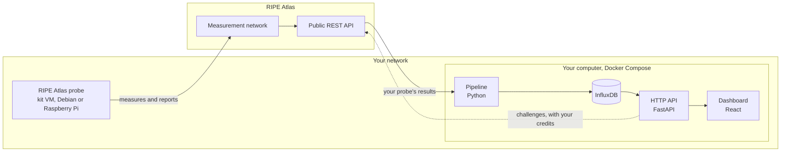

# Sondatlas

[](https://github.com/guilhermesvm/sondatlas/actions/workflows/tests.yml)

Sondatlas is an educational kit for taking part in [RIPE Atlas](https://atlas.ripe.net/),
the global Internet measurement network run by the RIPE NCC. It helps you host
an official RIPE Atlas Software Probe on your own computer and then follow and
understand what that probe measures, through a guided dashboard in Portuguese.

It was built for an undergraduate thesis on monitoring and analyzing Internet
performance and connectivity with RIPE Atlas probe data, as a minimum kit that
students and enthusiasts can replicate.

## What it does

- **Hosts a probe.** The `lab/` folder creates a Debian virtual machine with the
  official Software Probe (Vagrant + VirtualBox, same command on Windows and
  Linux), or installs the probe directly on Debian or Raspberry Pi OS.
- **Guides you step by step.** The dashboard is a six-phase journey: *Conhecer*
  (learn what RIPE Atlas is), *Instalar*, *Ativar*, *Acompanhar* (follow your
  probe), *Aprender* (lessons on ping, IP and traceroute, with exercises) and
  *Explorar*.
- **Keeps your probe's history.** A pipeline collects your probe's results for
  two pings (K-root and Google) from the public RIPE Atlas API and stores them in
  InfluxDB, so the dashboard can show RTT and packet loss over time.
- **Turns credits into challenges.** A running probe earns RIPE Atlas credits.
  With your RIPE Atlas API key, the dashboard creates your own measurements
  (challenges) with those credits, always showing the cost before you confirm,
  and awards badges.

Everything runs on your computer. The application only reads the public
RIPE Atlas API and never talks to the probe directly.

## How it works



The probe and the application are separate. The probe sends its results to
RIPE Atlas, and the application reads them back from the public API. You can
turn each one on or off independently, and recreating the probe VM never
deletes your history.

## Requirements

- [Git](https://git-scm.com/) and Docker: Docker Desktop on Windows, or Docker
  Engine with the Compose plugin **2.24.0 or later** on Linux.
- For the probe VM: [VirtualBox 7](https://www.virtualbox.org/),
  [Vagrant](https://developer.hashicorp.com/vagrant/install) and hardware
  virtualization enabled in the BIOS. Not needed if the probe runs directly on
  Debian or a Raspberry Pi.
- A free RIPE NCC Access account, to register the probe at RIPE Atlas.
- About 5 GB of disk (VM, Debian box, images and data) and about 1.3 GB of RAM
  for the VM and the containers, plus Docker itself.

Validated on Windows 11. Linux as a host has not been tested yet.

## Quick start

1. **Get the project.**

   ```bash
   git clone https://github.com/guilhermesvm/sondatlas.git
   cd sondatlas
   ```

2. **Start the application.** On the first run there is no probe VM yet, so
   only the application starts, and the dashboard opens at
   `http://127.0.0.1:8080/`.

   | Terminal | Start | Stop |
   |---|---|---|
   | PowerShell (Windows) | `powershell -ExecutionPolicy Bypass -File .\start-kit.ps1` | `powershell -ExecutionPolicy Bypass -File .\stop-kit.ps1` |
   | Git Bash (Windows) or Linux | `bash start-kit.sh` | `bash stop-kit.sh` |

   `-ExecutionPolicy Bypass` applies only to that run, because Windows blocks
   scripts by default.

3. **Install the probe.** Follow the *Instalar* phase in the dashboard. With
   the VM, run `start-kit` with `--probe` (`-Probe` in PowerShell): it checks
   virtualization, VirtualBox and Vagrant, creates the VM and shows the probe's
   public key at the end. Without the VM, run `sudo bash lab/install-probe.sh`
   on the Debian or Raspberry Pi. Details in [`lab/README.md`](lab/README.md).

4. **Register and activate the probe.** Registration at RIPE Atlas is manual:
   follow the *Ativar* phase. Then, in the *Acompanhar* phase, type your probe
   ID so the pipeline starts collecting its results.

Day to day, the same scripts start and stop everything. Add one option to
handle only one part:

| Option | `start-kit` | `stop-kit` |
|---|---|---|
| none | Starts the application and, when it exists, the probe VM | Stops both |
| `--probe` / `-Probe` | Creates or starts only the VM | Stops only the VM |
| `--app` / `-App` | Starts only the application | Stops only the application; the probe keeps measuring and earning credits |

While the application is off, your probe's results stay at RIPE Atlas, and the
pipeline collects the gap on the next start. Both scripts are safe to run again
and never delete data.

### If a port is already in use

If start-up reports `port is already allocated`, another program or another
copy of the project uses the port. Choose other ports in a `.env` file at the
project root and start again:

```dotenv
WEB_PORT=8081       # dashboard, default 8080
API_PORT=8001       # HTTP API, default 8000
INFLUXDB_PORT=8087  # InfluxDB, default 8086
```

### InfluxDB access

On the first start, a short-lived `init` service generates the InfluxDB
password and token at random, without displaying them, and InfluxDB configures
itself. To open the InfluxDB interface at `http://localhost:8086/`, log in as
`admin` with the password shown by:

```bash
docker compose exec influxdb2 cat /run/kit-secrets/influxdb-admin-password
```

## Data and privacy

| What | Where |
|---|---|
| Measurement history | InfluxDB, in a Docker volume |
| Raw and normalized API responses | `data/raw/` and `data/normalized/` |
| Selected probe, collection progress and your RIPE Atlas API key | `data/state/` |
| InfluxDB password and token | The `influxdb2-secrets` Docker volume |

None of these files are tracked by Git. Every port listens only on
`127.0.0.1`, and the API has no authentication, so do not expose it to a
network. **`docker compose down -v` deletes the whole measurement history**;
`stop-kit` and `docker compose stop` keep everything.

Measurements from public probes are public at RIPE Atlas. The dashboard asks
before creating any measurement that spends your credits.

## Project structure

```text
lab/                      probe kit: Vagrantfile, VM preparation, probe installer, guide
src/sondatlas/            Python package
    __main__.py           pipeline entry point (python -m sondatlas)
    init_secrets.py       generates the InfluxDB password and token for Compose
    shared/               configuration, probe selection, RIPE Atlas client, lock
    pipeline/             collection: RIPE Atlas -> JSON files -> InfluxDB
    api/                  FastAPI routes for the dashboard
frontend/                 React + TypeScript dashboard (Vite, Mantine)
tests/                    Python tests (pytest)
scripts/                  maintenance: InfluxDB check, JSON cleanup
data/                     local data and state (not tracked)
compose.yaml, Dockerfile  the application stack
start-kit.*, stop-kit.*   one-command start and stop (.ps1 and .sh)
```

`pipeline/` and `api/` import from `shared/`, never from each other.

## Development

Python 3.11 or later, from the project root:

```bash
python -m venv .venv
source .venv/Scripts/activate          # Git Bash; on Linux: source .venv/bin/activate
python -m pip install -e ".[dev]"
python -m pytest -q
```

Pipeline commands, on the host or inside the container with
`docker compose exec pipeline ...`:

```bash
python -m sondatlas --probe-id <ID>   # select the probe
python -m sondatlas                   # one collection cycle
python -m sondatlas --poll            # continuous collection
python -m sondatlas --all-time        # manual backfill of the probe's history
```

Do not run the host pipeline and the container pipeline at the same time: their
locks cannot see each other. To run Python on the host, copy `.env.example` to
`.env` and fill in `INFLUXDB_TOKEN` (read it with
`docker compose exec api cat /run/kit-secrets/influxdb-token`).

HTTP API, with interactive documentation at `http://127.0.0.1:8000/docs`:

```bash
python -m uvicorn sondatlas.api.app:app --host 127.0.0.1 --port 8000
```

Dashboard, with Node.js 22.12 or later; Vite forwards `/api` to port 8000:

```bash
cd frontend
npm ci
npm run dev      # http://127.0.0.1:5173/
npm test
npm run build
```

After changing code, rebuild the stack with `docker compose up -d --build`.
`python scripts/check_influxdb.py` checks the InfluxDB connection, and
`python scripts/cleanup_json.py` deletes the local JSON files. GitHub Actions
runs the Python and frontend tests on every push and pull request.

## Limitations

- Linux as a host, the Raspberry Pi and IPv6 have not been tested.
- The measurement catalog is fixed: two pings, K-root and Google.
- The application is meant to run locally, for one person and one probe at a
  time.
- A probe only measures while its machine is on and connected. A computer that
  is always on and wired to the router works best: Wi-Fi can add delay and
  variation to the measurements.

## Uninstalling

To recreate the probe VM, remove an orphaned VM or uninstall everything, see
"Recriar ou remover" in [`lab/README.md`](lab/README.md).

## Further documentation

- [`lab/README.md`](lab/README.md): probe kit guide, in Portuguese.
- `http://127.0.0.1:8000/docs`: API reference, while the application runs.
- [RIPE Atlas documentation](https://atlas.ripe.net/docs/) and the
  [Software Probe repository](https://github.com/RIPE-NCC/ripe-atlas-software-probe).

Questions and problems: [GitHub Issues](https://github.com/guilhermesvm/sondatlas/issues).

## Acknowledgments

RIPE Atlas and the Software Probe are run and maintained by the
[RIPE NCC](https://www.ripe.net/). Sondatlas is an independent project and is
not affiliated with the RIPE NCC.

## License

[MIT](LICENSE)
